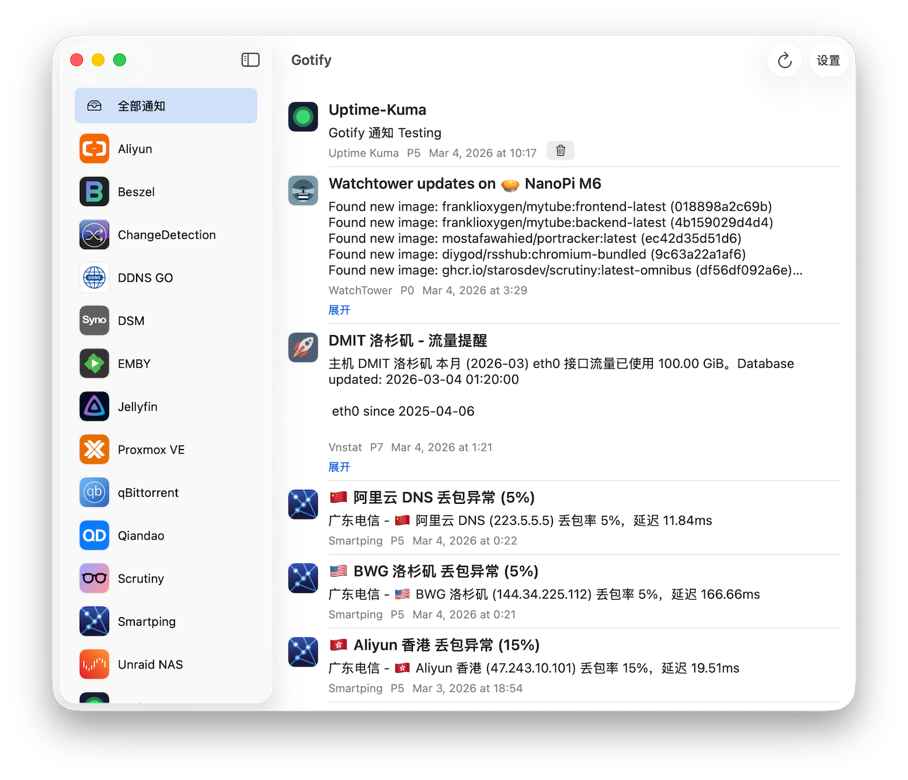

# Gotify-Swift

一个基于 SwiftUI 的 macOS Gotify 客户端，纯 Vide Coding。
支持实时接收消息、历史消息查看、侧边栏按应用筛选、状态栏通知面板等。

## 功能

- 实时 WebSocket 接收 Gotify 消息
- 首次/手动刷新加载最近 50 条历史消息，滚动到底部再加载 50 条
- 侧边栏按通知应用（App）筛选
- 状态栏图标与最近通知面板
- 支持删除消息、展开长消息、URL 点击跳转默认浏览器
- 支持快捷键：
  - `Cmd + R` 刷新
  - `Cmd + 1` 全部通知
  - `Cmd + 2..9` 快速切换侧边栏应用

## 运行环境

- macOS
- Xcode 15+
- Swift 5+

## 快速开始

1. 克隆仓库
2. 用 Xcode 打开 `Gotify-Swift.xcodeproj`
3. 选择目标设备（My Mac）并运行
4. 在应用设置中填写：
   - Gotify 服务器地址（如 `https://gotify.example.com`）
   - Client Token
5. 点击“保存并重连”

## 开机启动与后台运行

- 首次启动会请求是否开机自启
- 关闭主窗口后应用仍在后台运行（状态栏常驻）
- 关闭主窗口时取消历史加载并释放列表，只保留状态栏需要的最近 8 条通知；重新打开从第一页加载

## 目录结构

- `Gotify-Swift/Views`：界面
- `Gotify-Swift/ViewModels`：状态管理
- `Gotify-Swift/Services`：网络、通知、缓存等服务
- `Gotify-Swift/Models`：数据模型

## 验证

运行 `Tests/run-history-tests.sh` 验证分页、关闭窗口释放历史、重开、取消请求和失败重试。测试使用模拟网络响应，不访问实际 Gotify 服务。

## License

MIT
